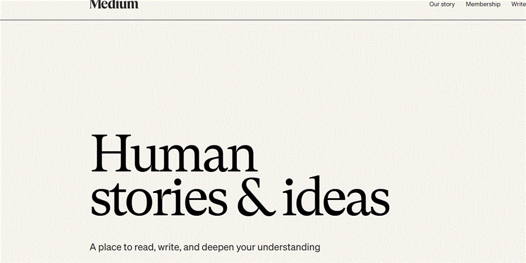

# Snapoff

Screenshot and annotate for Windows. Drag an area, draw on it in place, `Ctrl+C`.



*Recorded on a real desktop (an Edge window showing Medium's landing page). The selection is driven by posted mouse messages so the recording is reproducible: `Snapoff-e2e.exe --demo`.*

**One `.cs` file. 53 KB exe. Zero network code. No installer, no registry, no telemetry.** It builds with the C# compiler Windows already ships — no .NET SDK, no NuGet, no dependencies.

```
Snapoff.exe        53,760 bytes   (one file, the whole application)
Snapoff.cs          1,587 lines   (UI + capture + annotation + settings)
Snapoff-test.cs       717 lines   (test-only build: --selftest, --e2e, --clipcheck)
network imports           0       (no ws2_32 / wininet / winhttp / urlmon / dnsapi / mswsock)
registry writes           0
requirements              .NET Framework 4.x, already present on Windows 7/10/11
```

## Why this exists

Every screenshot tool that is pleasant to use also wants an account, an upload, or a cloud link. This one has no code path to the network at all — not a policy, just absent. You can check that yourself instead of trusting a privacy page:

```bash
for d in ws2_32 wininet winhttp urlmon dnsapi mswsock; do
  printf "%s=%s " "$d" "$(grep -a -o -i "$d" Snapoff.exe | wc -l)"
done
```

See [docs/audit.md](docs/audit.md) for the full audit: what it writes to disk, how to reproduce every claim, and what is *not* verified.

## What it does

- Global hotkey `PrtSc` (fallback `Ctrl+PrtSc`), or the tray menu.
- Overlay covers every monitor. Drag to select, `Enter` selects the whole screen, `Esc` cancels.
- Annotate **in the same overlay** — no second window, no editor dialog: arrow, line, box, highlighter, text, blur, mosaic.
- Text is typed directly where you click: `Enter` commits, `Esc` cancels, one `Ctrl+Z` takes it back.
- Resize the selection afterwards with 8 handles, move it with `Ctrl`+drag; annotations stay glued to the same content.
- 6 colours, 4 thicknesses, undo 20 steps, `Ctrl+C` copy + save, `Ctrl+S` save as PNG/JPEG/BMP.
- Output failures are visible and never lose the image: the file is written **before** the clipboard is touched.
- Settings live in `settings.ini` next to the exe — result folder, PNG/JPEG + quality, hotkey mode, autostart. Autostart is a `.cmd` in the Startup folder, not a registry `Run` entry.

Controls:

| Action | Key |
|---|---|
| Capture | `PrtSc`, `Ctrl+PrtSc`, or tray menu |
| Select whole screen | `Enter` |
| Cancel | `Esc` |
| Arrow / Line / Box / Highlighter / Text | `P` / `L` / `K` / `S` / `T` |
| Blur / Mosaic | `B` / `M` |
| Undo | `Ctrl+Z` |
| Copy + save + close | `Ctrl+C` or `Enter` |
| Save as | `Ctrl+S` |

## First run

1. Extract the zip anywhere **writable** and run `Snapoff.exe`. A tray icon appears — on Windows 11 it may be hidden behind the `^` overflow arrow in the taskbar.
2. Press `PrtSc` to capture. If that opens Windows' own Snipping Tool instead, the key belongs to the OS: disable it in Settings → Accessibility → Keyboard, or switch this app to `Ctrl+PrtSc` from tray → Settings.
3. The result goes to the clipboard and to `Pictures\snapoff` (folder, format and JPEG quality are all adjustable in Settings).

The interface is currently in **Indonesian**; this README is English. An i18n pass has not been done yet.

## Build

From this folder:

```bat
build.cmd
```

It produces two exes: `Snapoff.exe` (the product, no test code) and `Snapoff-e2e.exe` (same source plus `Snapoff-test.cs`, compiled with `/define:E2E`). If the Windows SDK with `rc.exe` is present, `build.cmd` also embeds icon + version info (`snapoff.rc` → `snapoff.res`); without it, the icon is still embedded via `/win32icon` and only the version block is missing.

Manual, if you prefer to see every flag:

```bat
%WINDIR%\Microsoft.NET\Framework64\v4.0.30319\csc.exe /nologo /target:winexe ^
  /win32icon:app.ico /out:Snapoff.exe ^
  /r:System.Windows.Forms.dll /r:System.Drawing.dll Snapoff.cs
```

That vendor compiler is C# 5 — no string interpolation, no `?.`, no expression-bodied members. That constraint is deliberate: it means the tool builds on a stock Windows machine with nothing installed.

## Verify

```bash
./Snapoff-e2e.exe --selftest    # must exit 0; prints every measured number
./Snapoff-e2e.exe --clipcheck   # clipboard write + read, with timings
./Snapoff-e2e.exe --e2e "C:\Temp\overlay.png"   # drives the real overlay on screen
./Snapoff-e2e.exe --demo        # same overlay, but drags the selection with posted mouse
                                # messages and annotates slowly — this is what recorded the GIF
./Snapoff.exe --selftest        # release build: prints one line, exits 2 (no test code inside)
```

`--selftest` is not a smoke test. It asserts on pixels and geometry, and prints the numbers so you can disagree with them: toolbar bounds outside the captured area and centred within 1 px, stroke pixel counts before/after a resize, red-pixel counts for committed text, mosaic vs blur column boundaries, settings round-trip, hotkey collision, DPI awareness level, monitor rectangles vs `VirtualScreen`.

## Limits (not claimed, because not proven)

- Mixed-DPI correctness is proven *mechanically*, not on mixed hardware: process awareness reads back as per-monitor, `VirtualScreen` equals the union of monitor rectangles, a full capture matches the screen size, and a selected 1100×500 area produces a 1100×500 PNG. Two monitors at different scale factors have not been tested.
- Clipboard retry (5 × 120 ms) is correct for transient contention; it was never verified under a permanently blocked clipboard, because that was the environment it was developed in.
- Annotation thickness and toolbar height are physical pixels, so they look thinner/smaller at 125–150% display scaling (sharp, not scaled).
- Autostart writes one `Snapoff.cmd` into your Startup folder, and it is reconciled in both directions on every launch: the path is rewritten when the exe moved, and the file is removed when autostart is off. Verified on Windows 11 against a real Startup folder (create, repair a stale path, run the `.cmd`, remove).
- It is unsigned. SmartScreen may warn on the first run of a downloaded binary; building from source avoids that entirely.
- There is no installer and no uninstaller. Extraction folder must be **writable** (Desktop, Documents, a USB stick) — inside `Program Files`, `settings.ini` cannot be written and preferences will not persist.
- The "desktop locked" capture path is readable code and a visible message, not an automated test.
- Version 0.9.0.0 — pre-1.0 on purpose: the gates below are not all passed yet.

## License

MIT — see [LICENSE](LICENSE).

## Removing it

There is no uninstaller because there is nothing installed. Delete the folder you extracted, then, if you used these:
- the settings file: `settings.ini` next to `Snapoff.exe`
- autostart: `Snapoff.cmd` in `%APPDATA%\Microsoft\Windows\Start Menu\Programs\Startup`
- captures: the output folder shown in Settings (default `Pictures\snapoff`)

Nothing else is left behind: no registry keys, no services, no cache directory.

---

If you need ready-made web templates rather than desktop tools, that is what I do for a living: [github.com/azimahmad99](https://github.com/azimahmad99).
